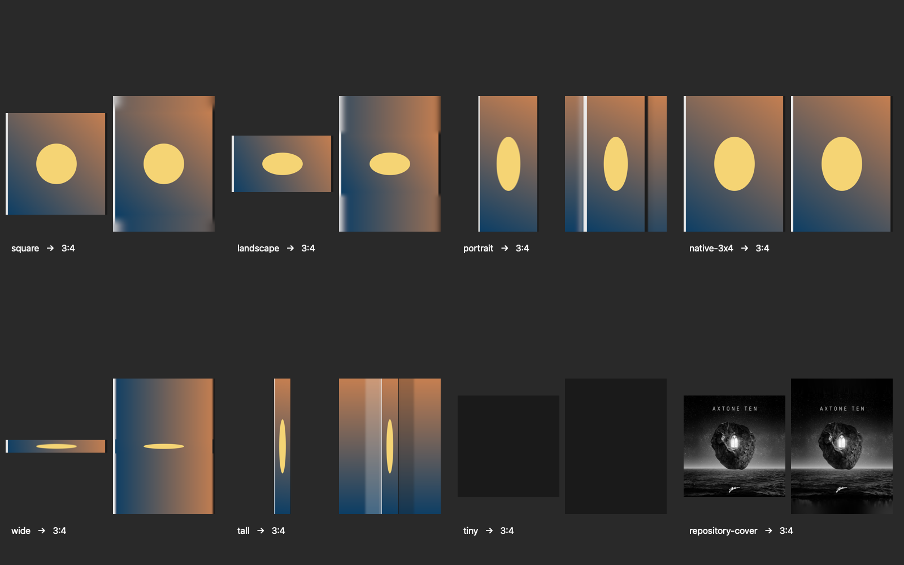

# Aonsoku — iOS 沉浸式锁屏封面适配目标

> 当前输出尺寸、最小延伸、全屏展示选项及消费需求分离规则已按 [resolution.md](resolution.md) 实现。下文保留此前固定尺寸实验与历史设备结果，不能将其 720px/1200px 数值当作当前生成上限或 Apple 要求。


## 项目背景

Aonsoku 是基于 Navidrome/Subsonic 的音乐播放器。希望在现有 iOS 音频播放功能的基础上，实现类似 Apple Music 的沉浸式全屏锁屏专辑封面。

## 核心目标

### 1. 沉浸式静态锁屏封面

- 优先实现 iOS 26+ 的 3:4 沉浸式锁屏专辑封面。
- 第一阶段只要求静态效果，不需要真正的动态封面。
- 尽可能利用 Apple 官方公开 API 实现，具体技术方案由 Agent 调研和规划。
- 如果系统不支持纯静态 3:4 全屏展示，允许探索视觉效果等价的替代方案。
- 尊重 iOS 系统对锁屏封面展开、布局和显示状态的控制，不使用私有 API。

### 2. 专辑封面自然扩展

现有专辑封面可能是 1:1，也可能是其他宽高比，需要自动适配为 3:4。

**期望视觉效果：**

- 保留原始专辑封面的主体内容及原始宽高比。
- 将图片边缘通过颜色延伸、模糊过渡等方式自然扩充到 3:4。
- 扩展部分与原图在色彩、纹理和整体氛围上保持一致。
- 原图与扩展区域之间不应出现明显边界、硬切割、色块或突兀的模糊分界线。
- 不希望出现简单地将方形封面叠加在模糊背景上的卡片式布局。
- 尽可能呈现一张完整、连续、自然的竖版专辑封面，而不是两层图片的拼接效果。
- 适配不同尺寸、分辨率和宽高比的图片，尽量避免主体内容被裁切或变形。

### 3. 与现有播放器集成

- 复用 Aonsoku 已有的音频播放、锁屏控制和专辑封面数据。
- 不要求 Navidrome/Subsonic 提供额外的动态封面或音乐元数据。
- 不影响现有播放、暂停、切歌、进度控制、后台播放及离线播放。
- 封面处理应尽量高效，避免明显增加播放延迟、电量消耗或存储占用。
- 对旧版 iOS 和不支持相关效果的设备提供正常的静态封面回退。

## 验收标准

1. 播放任意具有专辑封面的歌曲时，能够自动生成视觉自然的 3:4 封面。
2. 原始图片与延伸区域之间没有明显的拼接痕迹。
3. 在系统允许的情况下，锁屏能够呈现类似 Apple Music 的沉浸式大幅封面效果。
4. 不需要用户额外准备封面素材或修改音乐服务器。
5. 不破坏 Aonsoku 现有音频功能和兼容性。

## Agent 工作要求

请先阅读现有仓库中的 iOS 音频播放和 Now Playing 相关代码，结合 Apple 官方文档自行调研、规划并实施。

优先保证视觉自然度、系统兼容性和现有功能稳定性。具体架构、图片处理算法、缓存策略及 API 选择均由 Agent 决定。

## 实施记录（2026-10-13 至 2026-10-14）

### 官方 API 调研与方案

- Apple 的 [Providing animated artwork for media items](https://developer.apple.com/documentation/mediaplayer/providing-animated-artwork-for-media-items)
  描述了公开的 `MPMediaItemAnimatedArtwork`、
  `MPNowPlayingInfoProperty3x4AnimatedArtwork` 和
  `MPNowPlayingInfoCenter.supportedAnimatedArtworkKeys`。
- 该接口需要同为 3:4 的预览图片与本地视频文件；普通
  `MPMediaItemArtwork` 没有承诺可以触发 3:4 沉浸式布局。
  因此采用「静态竖版预览 + 相同画面的无声 H.264 短视频」，视觉上保持静止。
  这是基于公开接口的替代实现，是否展开和实际显示尺寸仍由 iOS 与用户决定。
- 保留普通封面；仅 iOS 26+ 且系统声明支持相应比例时增加新字段。
  同时适配 3:4 和 1:1，具体以 `supportedAnimatedArtworkKeys` 为准。
  低电量、低数据、热限制、减少动态效果等情况下，系统可以使用竖版预览。
  旧系统、不支持的平台及处理失败时保留正常静态封面。

### 已实现

- 新增 iOS 原生封面处理模块，图片限尺寸解码后按原始比例完整放入
  720×960（3:4）或 720×720（1:1）画布。延伸区使用边缘窄带的反射纹理、逐渐减缓的延展坐标及
  随边缘距离平滑增加的模糊；主体区域不参与模糊，无卡片阴影或裁切。
- 原封面先发布，竖版生成在独立 utility 队列执行；初版系统实际请求视频时才编码
  单帧保持 2 秒且无音轨的 MP4，不创建额外的播放会话。
  这样避免多帧 H.264 量化变化造成轻微闪动；初版仓库封面的样例视频约 16 KiB。
  后续动态封面实现已改为发布前准备静止/动态视频，系统 URL handler 只读现成文件；
  开关、DAV2 FP16/P8/P6 自动档位与按需模型下载见 `motion_cover.md` 第 8 节。
- 复用现有本地封面/原生下载链路，支持离线封面及远程播放投影。
  所有异步发布检查 Now Playing revision；切换封面或无封面时清除两种旧比例字段。
- 派生视频按内容 SHA-256、输出尺寸与算法版本复用，不持久化认证 URL。
  使用不备份的 Application Support 子目录与首次解锁后可读的文件保护。
  LRU 上限为 12 个文件/24 MiB；系统持有的封面对象会保护对应文件，
  因此活跃引用可暂时超过上限，随后在下一次处理时清理。

### 自动验证与视觉检查

- `node scripts/ios/test-lock-screen-artwork.mjs`：已通过。
  macOS + Xcode 下直接编译并运行生产代码，不需要音乐服务器或模拟数据库。
  测试包括方形、横向、纵向、原生 3:4、极端比例、1×1、透明图、4000×2000 图片
  及 EXIF 方向；逐像素确认缩放后的原图主体未被裁切/模糊，检查接缝连续性。
  视频检查包括 720×960/720×720、2 秒、无音轨、前后解码画面完全相同、方向/颜色一致；
  两种比例的图像主体均逐像素检查，且缓存 ID/文件互不覆盖。
  缓存检查包括发布前准备、并发请求合并、同图复用、换图 ID 更新、重启复用、
  活跃引用保护、释放后淘汰及无法写入时返回失败回退。
- Xcode 27.1：iOS Simulator（arm64/x86_64）和 generic iOS（arm64）
  的 App 构建已通过，最低部署版本仍为 iOS 15。
- `pnpm run lint`：已通过。
- 已检查下面的原图/生成图对照。测试输出保存在
  `/tmp/aonsoku-artwork-qa`，可传入自定义目录；目录中的
  `static-artwork.mp4` 可用于播放器检查。图像生成在原生测试中完成，未调用 AI 图像服务。



### 系统限制与实机验收清单

资源生成和编译已验证，**指定 iPad 的横屏 1:1 真机验收已通过**，其他设备与设置
组合仍需验证。公开 API 不提供强制展开、绕过系统设置或保证具体锁屏布局的方法。
边缘文字、边框、极端比例等素材可能保留可辨认的
边缘特征，本算法不生成不存在的新场景，不能保证所有任意图片都达到人工修图效果。

- [x] iPad Pro 11-inch（第 3 代）、iPadOS 27.2 横屏：系统请求 1:1 预览和
  本地视频，锁屏显示沉浸式静态封面；截图已核对，用户确认「效果可以了」。
- [ ] iOS 26+ 在线播放，点击锁屏封面展开，确认 3:4 大幅静态效果；
  Debug 的 `NowPlayingArtwork` 日志应出现 `3:4 artwork published`。
- [ ] 方形/横向/纵向、相邻同专辑和不同专辑歌曲，连续快速切换，
  确认标题与封面对应；无封面歌曲、停止和清空播放后不残留旧封面。
- [ ] 使用已经缓存的封面和音频，断网后播放与重启恢复，不额外请求服务器素材。
- [ ] 锁屏播放/暂停、上一首/下一首、拖动进度、后台播放和系统音频中断，
  确认控制、音频与进度保持正确。
- [ ] 远程控制投影、切换目标设备和 handoff，确认锁屏元数据与受控设备一致。
- [ ] 低电量、减少动态效果、关闭自动播放动画图像，确认预览或普通封面回退可用。
- [ ] iOS 26 以前或系统不声明支持任何动画封面比例的设备，确认普通封面与控制正常。

### iPad 实机问题定位与修复（2026-10-14）

用户报告 iPhone 正常、iPad 不生效。在用户指定的 iPad Pro 11-inch（第 3 代）
上安装同 bundle ID 的 Debug 构建，保留应用数据；设备实际版本为 iPadOS 27.2。

**已确认原因：** 系统仅返回 `MPNowPlayingInfoProperty1x1AnimatedArtwork`。
初版只提供 3:4，因此能力检查跳过新封面，退回普通静态封面。普通封面本身也可
展开成方形卡片，但这不代表新的沉浸式素材已生效。与 3:4 素材比例对应的并不是
设备横竖屏，不能把「需要竖过来」作为解决办法，也不能断言所有 iPad 都不支持。

修复后按系统能力提供 1:1/3:4 中支持的版本；原本已正常工作的 3:4 路径保留。
本次真机日志摘要（已省略歌曲标识与设备标识）：

```text
os=27.2 idiom=1 compiledAnimated=true
supportedKeys=["MPNowPlayingInfoProperty1x1AnimatedArtwork"]
lowPower=false thermal=0 reduceMotion=false
1:1 artwork published
1:1 preview requested size=(1668.0, 1668.0) returning=(720.0, 720.0)
1:1 video returned local=true bytes=51952 elapsedMs=432
1:1 video returned local=true bytes=51210 elapsedMs=67
1:1 video returned local=true bytes=51210 elapsedMs=1
```

后两条分别对应另一首歌曲的首次处理和已有视频的缓存命中。修复后已收到系统实际
资源请求、核对锁屏全屏背景截图，并获得用户确认。未将带有个人通知的截图或
原始应用控制台日志提交到仓库。

修复后的 3:4/1:1 原生资源测试、`pnpm run lint`、指定 iPad 的签名 Debug 构建
及 generic iOS Release 构建均通过。Debug 本地 JSONL 已从设备取回并验证可解析。

### 可重复的真机调试方法

`NowPlayingArtwork` 日志现在记录 SDK/OS、系统支持的比例、界面朝向、低电量/
热状态/减少动态效果、普通/两种比例封面的安装状态、过期结果丢弃，以及系统
预览和视频请求的尺寸、返回文件大小及耗时。无法写入/编码的失败记录错误域和代码。

Debug 构建可通过环境变量开启仅封面诊断的本地 JSONL 日志（上限约 512 KiB，
每次启用后的首次记录重新开始；普通启动与 Release 不写入）：

```bash
xcrun devicectl device process launch \
  --device "<UDID>" --terminate-existing --console \
  --environment-variables '{"AONSOKU_ARTWORK_TRACE":"1"}' \
  github.realtvop.aonsoku

xcrun devicectl device copy from \
  --device "<UDID>" \
  --domain-type appDataContainer --domain-identifier github.realtvop.aonsoku \
  --source Documents/lock-screen-artwork-debug.jsonl \
  --destination /tmp/aonsoku-artwork-debug.jsonl
```

播放有封面的歌曲、进入锁屏并点击封面展开后，先检查系统支持的 key，再检查
是否发布对应比例、是否收到系统预览/视频请求及是否成功返回本地文件。

### 代码入口

- `capacitor-plugins/capacitor-native/ios/Sources/AonsokuNativePlugin/Audio/`
  下的 `LockScreenArtworkRenderer.swift`（图像）、
  `LockScreenArtworkVideo.swift`（静态视频）、
  `LockScreenArtworkStore.swift`（缓存与生命周期）。
- 同目录 `AonsokuNativeAudioPlugin.swift` 的 `publishNowPlayingArtwork`
  统一处理已有本地/网络图片，先发布普通封面，再按系统能力发布 3:4/1:1。
- `scripts/ios/lock-screen-artwork-tests.swift` 与
  `scripts/ios/test-lock-screen-artwork.mjs` 提供可重复的原生资源验证。


## 原图准入补充（2026-10-14）

静态沉浸视频也必须等待最终来源。数字 `coverSize`（100/300/700/800 等）和未知质量缓存仅用于普通锁屏封面；原生无 `size` 的 `getCoverArt` 请求完整成功并验证图片后标记为 `original`，随后才允许渲染/应用沉浸静态视频及继续动态阶段。等待或失败时不安装缩略图对应的沉浸对象。原图缓存跨实例防降级，旧缩略图视频按内容摘要隔离；原图仍经过最多 1200px 的受限解码，不改变输出视频规格和音频会话。来源判定、Debug 字段及回归详见 `motion_cover.md` 第 13 节。
